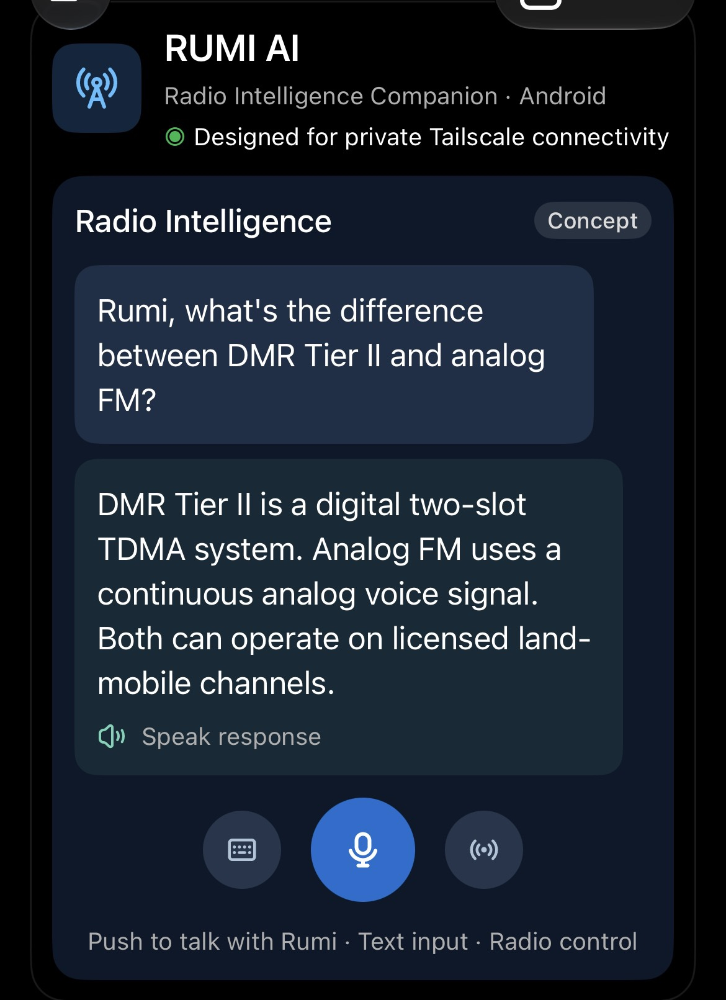

# RumiTX — 2030

### An open replacement for the DOOGEE S80 stock Talkie app

---

## The Problem

The DOOGEE S80 is a rugged phone with a built-in DMR/UHF radio module (DMR007, 400–470 MHz). Fantastic hardware — but the stock Talkie app is holding it back:

- **Clunky, outdated interface** that feels like 2015
- **No easy frequency programming** — manually punching in channels one by one
- **Limited channel management** — no import, no organization
- **Bugs that never get fixed** — the manufacturer moved on

Thousands of S80 owners are stuck with software that doesn't match the hardware's potential. Forum posts going back years ask the same question: *"Is there an alternative to the stock Talkie app?"*

**Until now, the answer was no.**

## What We Did

RumiTX is a from-scratch rebuild of the S80's radio interface, reverse-engineered from the stock app's HIDL HAL (`ITalkiePort`), the DMR007's UART binary protocol, and the kernel's HCT intercom driver.

### v2.3-beta-phase2 — What's Working

**Core Radio:**
- ✅ **RX audio** — Full receive path through the HIDL callback
- ✅ **TX** — Verified via RTL-SDR (on frequency within 100 Hz)
- ✅ **Analog + DMR** channel programming via DMR007 UART frames
- ✅ **Hardware PTT** — Side key + on-screen hold-to-talk
- ✅ **Auto-reconnect** — App automatically reconnects to the radio module if the link drops

**Repeater Database (NEW in v2.3):**
- ✅ **CSV import** — RepeaterBook and CHIRP format, your own personal-use exports
- ✅ **316 repeaters** imported and searchable
- ✅ **Tap to program** — Touch a repeater, module programs instantly
- ✅ **PL/DCS tone programming** — Standard 50-tone CTCSS and 83-code DCS tables; toned repeaters program automatically
- ✅ **Manual tone pickers** — Dropdown shows "100.0 Hz (13)" with module index
- ✅ **Nearest/radius search** — GPS-based repeater sorting

**Offline Maps (NEW in v2.3):**
- ✅ **Mapsforge vector maps** — Full offline rendering, no internet needed
- ✅ **Repeater pins** — Database entries shown on the map
- ✅ **GPS location** — Your position on the offline map

**DMR Identity (NEW in v2.3-phase2):**
- ✅ **Editable callsign and DMR ID** — Set your radio's identity, displayed on main screen
- ✅ **Persistent** — Survives app restarts

**UI:**
- ✅ **2030 holographic interface** — Futuristic dark theme with glowing accents
- ✅ **Channel bank** — Tap to tune, add custom channels
- ✅ **Discovery mode** — Scan for activity

### Coming Soon
- **DMR text messaging** — Pending UART probe to verify module data-frame support
- **ATAK integration** — CoT position sharing, repeater markers, team messaging

## 🧠 RUMI AI — Local Radio Intelligence (Working!)

**Talk to your radio. It understands.**

We're training a custom AI model that runs entirely on-device — no cloud, no internet, no latency. Just tell it what you want in plain English and it handles the rest.

### What It Does

**Voice-to-Radio Control:**
- *"Switch to channel 5"* → Channel changes instantly
- *"Make the VFO 446.00625 MHz"* → Frequency set, validated against your authorized list
- *"Send a text to ops saying I'm on site"* → DMR text composed, ready for your confirmation

**Radio Knowledge Brain (v2):**
- *"What's the national calling frequency?"* → Instant answer
- *"What's the difference between DMR Tier II and analog FM?"* → Clear explanation
- *"What's the repeater offset for 146.52?"* → Band plan knowledge on tap
- Emergency frequencies, first-responder protocols, first-aid basics — all offline

**Spectrum Analyzer Integration:**
- *"Scan 440 to 450 MHz"* → Triggers a spectrum sweep, shows you what's there
- *"What's that signal at 446.00625?"* → Identifies what you're hearing
- Voice-controlled waterfall, signal identification, one interface for radio AND spectrum

### How It Works

The model is a fine-tuned Qwen2.5 (0.5B parameters — tiny, fast, runs on the S80) trained specifically on radio commands and amateur radio knowledge. A deterministic safety validator independently checks every command against your channel plan and authorizations before anything touches RF hardware. The AI proposes, the validator gates, you confirm.

**No cloud. No subscription. No data leaves your device.**

### Download the V3 Model

The V3 AI model (Qwen3-1.7B, Q4_K_M, 1.1 GB) is ready:
**https://drive.google.com/file/d/1xVuMrUCNjA5W-OVy8lpBIHOlOCeOnwti/view?usp=sharing**

1. Download the GGUF file (1.1 GB)
2. Copy to phone: /sdcard/RumiTX/v3_model.gguf
3. RumiTX > Settings > AI Model > select the file
4. Runs entirely on-device, no internet needed

SHA-256: a9d99ed72848f0c26d2c380490108102aa19b47d565b192b7719e0d1f8832ba1

### Voice TX Bridge (Working!)

Say "transmit [message] on [frequency]" and the app converts your
speech to DMR digital and broadcasts it. DMR digital only.

### Sneak Peek

*Early concept: Push to talk with Rumi, text input, radio control — all in one interface*

## Support

If RumiTX is useful to you, consider supporting the project:

One-time tips and monthly support both help keep development going.

## License

MIT — see [LICENSE](LICENSE) for details.
