# RumiTX — 2030

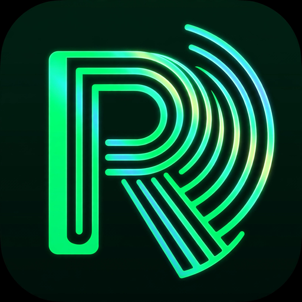

### An open replacement for the DOOGEE S80 stock Talkie app

## The Problem

The DOOGEE S80 is a rugged phone with a built-in DMR/UHF radio module (DMR007, 400–470 MHz). Fantastic hardware — but the stock Talkie app is holding it back:

- **Clunky, outdated interface** that feels like 2015
- **No easy frequency programming** — manually punching in channels one by one
- **Limited channel management** — no import, no organization
- **Bugs that never get fixed** — the manufacturer moved on

Thousands of S80 owners are stuck with software that doesn't match the hardware's potential. Forum posts going back years ask the same question: *"Is there an alternative to the stock Talkie app?"*

**Until now, the answer was no.**

## What We Did

RumiTX is a from-scratch rebuild of the S80's radio interface, reverse-engineered from the stock app's HIDL HAL (`ITalkiePort`), the DMR007's UART binary protocol, and the kernel's HCT intercom driver.

### v2.3-beta-phase2 — What's Working

**Core Radio:**
- ✅ **RX audio** — Full receive path through the HIDL callback
- ✅ **TX** — Verified via RTL-SDR (on frequency within 100 Hz)
- ✅ **Analog + DMR** channel programming via DMR007 UART frames
- ✅ **Hardware PTT** — Side key + on-screen hold-to-talk
- ✅ **Auto-reconnect** — App automatically reconnects to the radio module if the link drops

**Repeater Database (NEW in v2.3):**
- ✅ **CSV import** — RepeaterBook and CHIRP format, your own personal-use exports
- ✅ **316 repeaters** imported and searchable
- ✅ **Tap to program** — Touch a repeater, module programs instantly
- ✅ **PL/DCS tone programming** — Standard 50-tone CTCSS and 83-code DCS tables; toned repeaters program automatically
- ✅ **Manual tone pickers** — Dropdown shows "100.0 Hz (13)" with module index
- ✅ **Nearest/radius search** — GPS-based repeater sorting

**Offline Maps (NEW in v2.3):**
- ✅ **Mapsforge vector maps** — Full offline rendering, no internet needed
- ✅ **Repeater pins** — Database entries shown on the map
- ✅ **GPS location** — Your position on the offline map

**DMR Identity (NEW in v2.3-phase2):**
- ✅ **Editable callsign and DMR ID** — Set your radio's identity, displayed on main screen
- ✅ **Persistent** — Survives app restarts

**UI:**
- ✅ **2030 holographic interface** — Futuristic dark theme with glowing accents
- ✅ **Channel bank** — Tap to tune, add custom channels
- ✅ **Discovery mode** — Scan for activity

### Coming Soon
- **DMR text messaging** — Pending UART probe to verify module data-frame support
- **ATAK integration** — CoT position sharing, repeater markers, team messaging

## Screenshots

### Main Interface
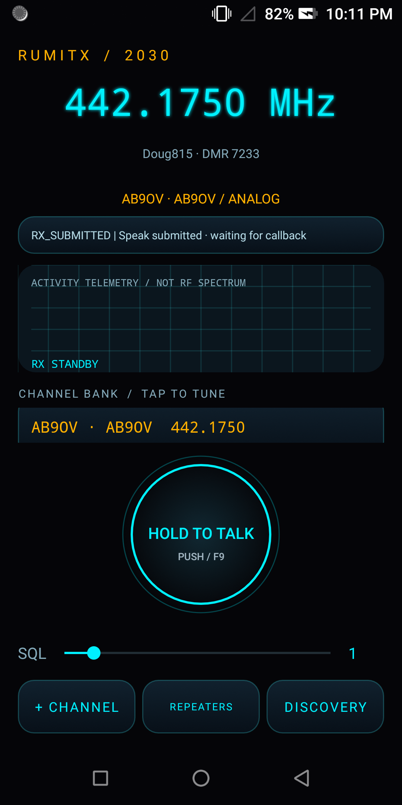
*The 2030 main interface — AB90V repeater tuned, DMR identity displayed*

### Transmitting
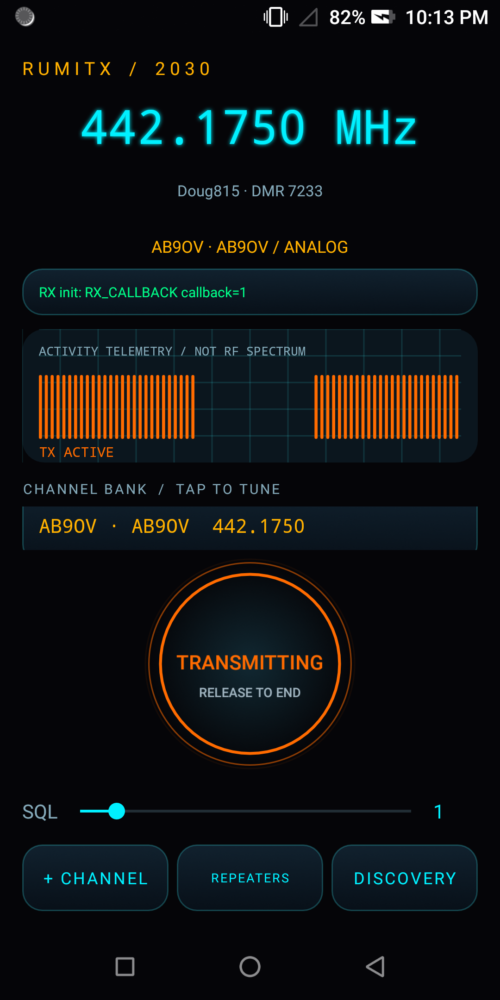
*Live transmission — activity telemetry shows TX bars, button glows orange*

### Repeater Database
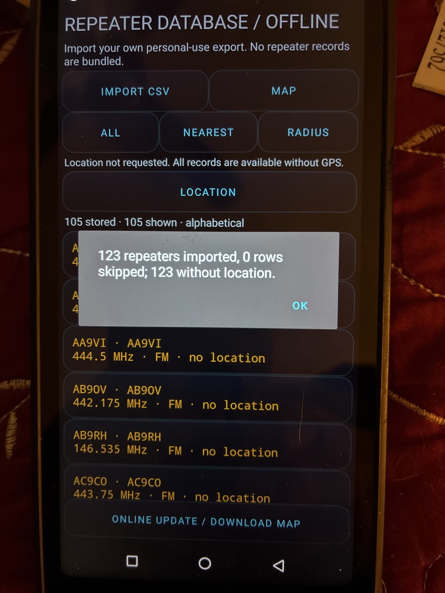
*316 repeaters imported, tap to program*

### Repeater List
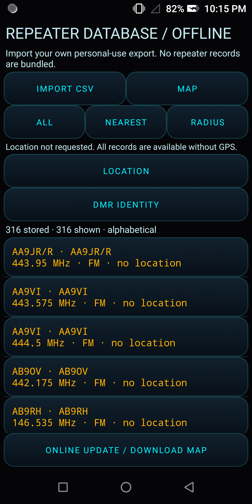
*Searchable repeater list with DMR identity editor*

### Repeater Detail
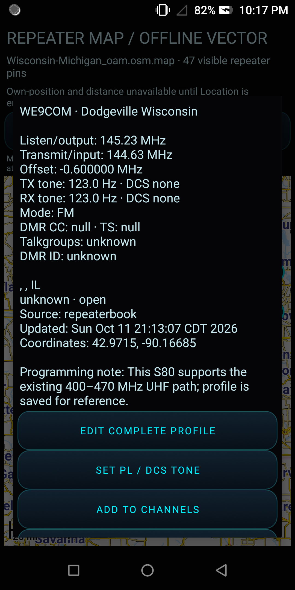
*Repeater info with tone programming and out-of-band detection*

### Offline Repeater Map
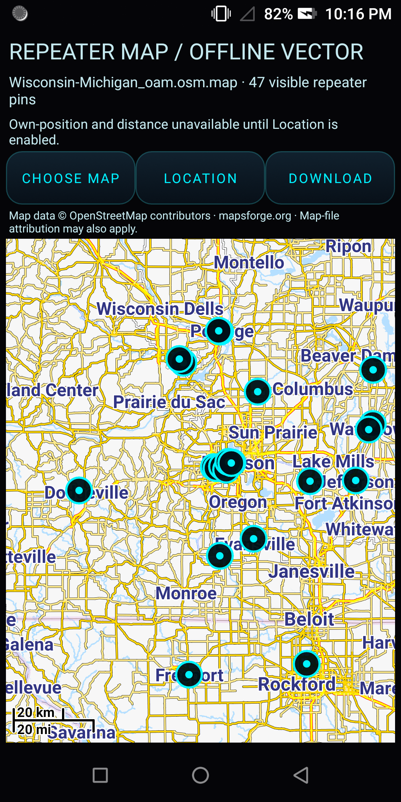
*Mapsforge vector map — 47 repeater pins across Wisconsin*

### Map Download
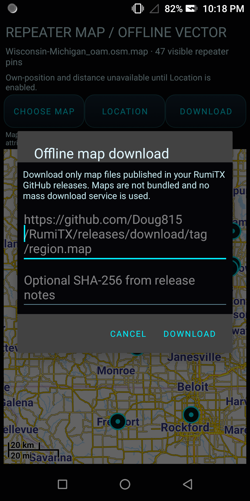
*Download offline maps from GitHub releases with SHA-256 verification*

### DMR Identity
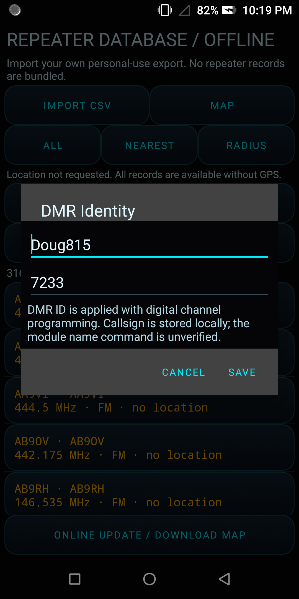
*Editable callsign and DMR ID*

### Tone Picker
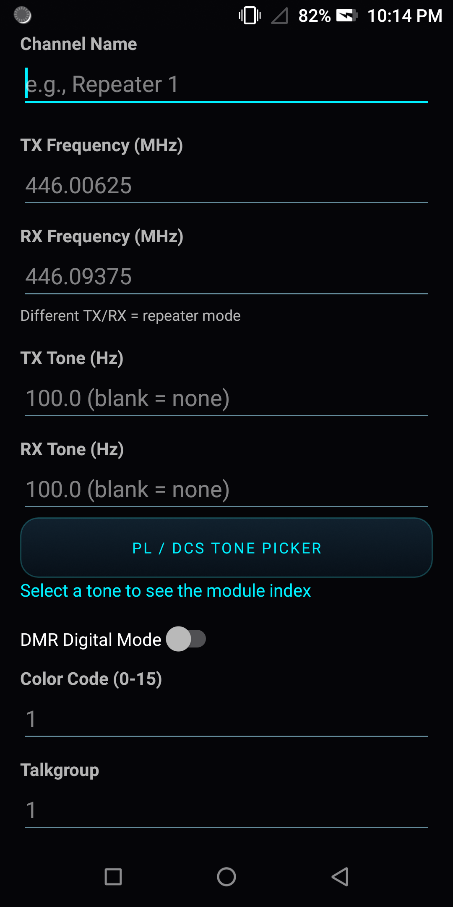
*Channel editor with PL/DCS tone picker*

### Tone Dropdown
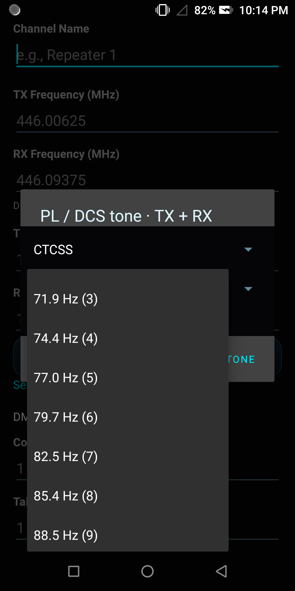
*Standard CTCSS tones with module indices — "88.5 Hz (9)"*

### Discovery Scan
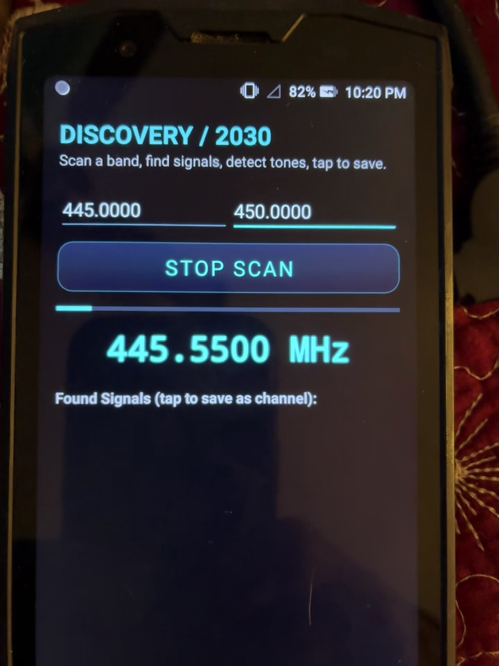
*Discovery mode — scan a band, find signals, tap to save*

## Technical Details

The DMR007 module is controlled through three layers:

1. **HIDL HAL** (`vendor.doogee.hardware.talkie@1.0::ITalkiePort`) — `talkie_init()`, `talkie_app_start()`, `talkie_speak_enable(callback)`. The speak-enable ioctl blocks waiting for a hardware interrupt that only fires after HIDL GPIO setup — this was the key insight that unlocked RX audio.

2. **UART protocol** (`/dev/ttyMT1`, 57600 8N1) — Binary frames starting with `0x68`. Channel programming uses `68 35` (analog) and `68 36` (digital) frames. Tone selection uses standard index tables (CTCSS 0-50, DCS 0-82).

3. **HCT kernel driver** (`/dev/hctintercom_node`) — PTT keying via ioctl, speaker/amp control.

The module is **exclusive** — only one app can own it at a time. A native helper (`rumitx-ptt`) runs as a daemon and the app connects via TCP on `127.0.0.1:45921`.

## Installing

**Technical preview.** Requires:
- DOOGEE S80 (Android 8.1)
- `rumitx-ptt` helper binary at `/data/local/tmp/rumitx-ptt` (see source)
- ADB for installation
- SELinux permissive
- Offline map files in `/sdcard/RumiTX/maps/` (Mapsforge .map format)
- Repeater CSV in `/sdcard/RumiTX/import/` (RepeaterBook or CHIRP format)

See the [releases page](../../releases) for APK downloads.

## Building

See source ZIP attached to each release for exact buildable source.

## Legal / Safety

**Only transmit where you are licensed or authorized to do so.** The S80's 400–480 MHz range covers amateur and commercial allocations that require a license in most countries. Test with an SDR receiver before transmitting, and never key the transmitter blindly.

## License

To be chosen before public release.

---

*Built with patience, reverse engineering, and an RTL-SDR.*
