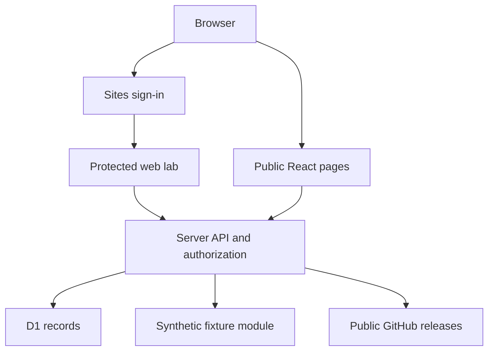

# RumiTX website and virtual lab

Live origin: https://rumitx-field-lab.realdvs1.chatgpt.site

A React/TypeScript site with a custom Three.js S80 approximation, authenticated web lab, forum, public release reader, and deterministic AI test bench. The chosen deployment uses GPT Sites (Vinext/Cloudflare Workers), Sites sign-in, and D1. This is a working partial implementation of the larger brief, not a finished Android emulator or Supabase deployment.

## Architecture



## What runs now

- Custom Three.js S80-inspired mesh: armored beveled body, orange trim, rear horizontal cameras, fingerprint block, whip antenna, illuminated screen, introductory rotation and reduced-motion support. A geometry approximation, not a photoreal scan.
- Protected /lab route and per-account state/logs. Admin email allowlist checked server-side on every hardware mutation. No first-user-is-admin or client-side role assignment.
- Web replica tabs for Radio, Repeaters, AI, and Map. Manual channel, GPS, battery, RSSI, heading, pressure test input, acceleration, and antenna state. State persists; logs export as JSON.
- Rule-based AI returns nonempty responses, prevents accidental TX execution, and logs input/context/output/computation latency. Admin channel commands update simulation state. Member prompts do not modify hardware.
- APK local inspection calculates actual SHA-256. No binary leaves the browser. It neither installs APKs nor verifies signatures/manifest version. It checks ZIP magic only, so it is not an APK security validator.
- Community discussions, replies, votes, solutions, pin/lock/delete moderation, search, categories, and editable display name/bio. SQL parameter binding, size limits, basic no-link filtering, account write throttling, and optimistic concurrency on thread edits.
- GitHub release metadata, assets and provided checksums. No fabricated download counts or version labels.
- Public synthetic repeater explorer, API docs, FAQ, legal text, SVG identity, press one-pager, robots and sitemap.
- Newsletter consent stored for signed-in users; email delivery is not connected.

## Deliberate substitutions and remaining gaps

The budget prohibits a credit-card-dependent signup. Sites runs request handlers in a Worker, not an Android VM. Its 128 MB isolate cannot host a persistent Android guest. Oracle documentation says most free-tier accounts require card verification. Appetize has a limited free plan but no account/API token was available, and exact S80 vendor HIDL/ARM hardware emulation was not established. No emulator was booted or trial minutes purchased. We used the explicitly permitted B6 fallback after architectural feasibility checking, not after claiming a failed device test.

- No real Android, APK installation, native JNI/HIDL, RF, audio, ATAK delivery, or exact fingerprint spoofing.
- Replica visuals are approximate, not pixel faithful. Uploaded hardware references and APK metadata were inspected; native screenshots are still needed.
- No Supabase project, Google OAuth, or email/password signup. Sites identity and D1 are deployed instead. See `docs/SUPABASE-MIGRATION.md` for the migration boundary.
- Repeater fixtures are bundled in memory, not a seeded production repeater table. TEST-* callsigns and all operational data are synthetic. Full 659-record data is not present.
- No live hosted LLM, auto battery drain, geographic tile map, avatar uploads, badges, newsletter email delivery, contact email form, approved stable APK promotion, sponsorship integration, or native screenshots/video.
- No 2-minute screen recording. Browser QA/recording capability was unavailable in the authoring environment. Do not substitute an animation and call it a recording.
- Community reads are capped at 200 newest discussions; replies are embedded per thread. This is a small-community implementation; pagination/normalized replies are needed at scale.
- Privacy/terms are initial project copy, not a legal review.

## Free service boundaries (checked October 17, 2026)

No paid account or credit card was used. No external paid inference is called.

| Service | Used? | Limit / risk |
| --- | --- | --- |
| GPT Sites / Worker / D1 | Yes | Managed by the user's ChatGPT Sites entitlement. 128 MB Worker memory. This tool does not expose a guaranteed free request/storage quota; no unlimited claim is made. Hosting availability follows the account/platform. |
| GitHub public REST | Yes | Unauthenticated requests share a 60 requests/hour/IP rate limit. Release/star panels show an error or dash when unavailable. No site-wide cache yet. |
| Google Fonts | Yes | Public stylesheet/font delivery; fallback system fonts are provided. External request disclosed in privacy copy. |
| Supabase Free | No | Official pricing advertises 500 MB database, 50k MAU, 1 GB file storage; verify current egress and function limits before migration. Free projects may pause when inactive. No project provisioned. |
| Appetize Free | No | Single user, 2 active devices maximum, 30 minutes refilled monthly. Not sufficient for an always-on shared lab. No account or trial consumed. |
| Oracle Free Tier | No | Most signups require card verification. Not provisioned under this budget rule. No VM promised. |
| Vercel/Netlify | No | Not provisioned; Sites is the selected hosting substitute. Their quotas do not apply to this deployment. |

Sources: https://supabase.com/pricing ; https://site.appetize.io/pricing ; https://support.appetize.io/may-i-test-appetize.io-for-free-before-paying-for-an-account ; https://docs.oracle.com/en/learn/cloud_free_tier/index.html ; https://docs.github.com/en/rest/using-the-rest-api/rate-limits-for-the-rest-api

## Local development

Node >=22.13 and pnpm. From this directory:

```sh
pnpm install --frozen-lockfile
pnpm dev
pnpm exec tsc --noEmit
node --experimental-strip-types scripts/test-simulation.mjs
pnpm build
```

The Sites workflow configures a portable execution profile outside the managed authoring image. Keep `sites()` in vite.config.ts. Do not remove the authentication integration. Follow the installed Sites skill's project setup/profile repair when cloning on a different host. See the starter documentation for local D1 migrations; the migration files live in `drizzle/`. Production migrations apply at Sites publication. Never run CREATE TABLE from request handlers.

Runtime secret: `ADMIN_EMAILS` is a comma-separated list of admin account emails. Set through Sites environment tools; never commit the values. `.env*` files are ignored. The site owner's account has been configured as administrator. Login with the same ChatGPT account, open Simulator, and look for ADMIN. No separate password is issued.

### Publishing

The authoritative deployed source is synced to the Sites source repository. `.openai/hosting.json` retains the exact project ID and `DB` binding. Use Sites `site-workflow.mjs` to build, push, and package the exact source commit, then save/deploy that archive. Public pages use public Site audience; /lab requires account sign-in and hardware APIs require admin.

The GitHub `website-lab` branch is a standalone website tree. Do not merge it into the Android main branch: it intentionally contains a separate application at its root. Create a dedicated repository later if preferred. Future maintainers should keep the Sites checkout and this branch synchronized.

## Rumi's change map

| Change | File |
| --- | --- |
| Landing copy and sections | app/page.tsx |
| Colors, responsive layout, typography | app/globals.css |
| 3D phone geometry/materials | components/Phone3D.tsx |
| Lab screens and controls | components/Lab.tsx |
| Simulation intent parsing | lib/simulation.ts |
| Fixture data and distance calculations | lib/simulation.ts |
| Backend routes and permissions | app/api/[...path]/route.ts |
| Identity/admin policy and persistence | lib/server.ts, app/chatgpt-auth.ts |
| Community | components/Community.tsx |
| Schema and migrations | db/schema.ts, drizzle/ |
| Release display | app/downloads/page.tsx |
| Reference APK inspection evidence | public/reference-build.json |
| Docs, policies and press kit | app/docs, app/legal, public/press-kit.txt |

## Reference APK

The supplied archive contains signed CI-debug and unsigned variants, not the original-key signed release. Package `com.rumitx.app`; versionName `2.3.2-llama-bundled`; versionCode `20301050`; minSdk 26, targetSdk 27; ARM64 libraries. The build README reports a separate 1,107,409,344-byte GGUF download. Do not publish the CI binary as a stable upgrade or uninstall the working app to bypass signing conflicts. No signing keys were accessed or copied.

See `TEST-REPORT.md` for validation and explicit limits.
