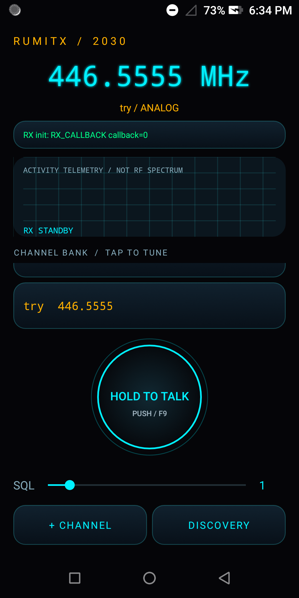

# RumiTX — 2030


### An open replacement for the DOOGEE S80 stock Talkie app



## The Problem

The DOOGEE S80 is a rugged phone with a built-in DMR/UHF radio module (DMR007, 400–470 MHz). Fantastic hardware — but the stock Talkie app is holding it back:

- **Clunky, outdated interface** that feels like 2015
- **No easy frequency programming** — manually punching in channels one by one
- **Limited channel management** — no import, no organization
- **Bugs that never get fixed** — the manufacturer moved on

Thousands of S80 owners are stuck with software that doesn't match the hardware's potential. Forum posts going back years ask the same question: *"Is there an alternative to the stock Talkie app?"*

**Until now, the answer was no.**

## What We Did

RumiTX is a from-scratch rebuild of the S80's radio interface, reverse-engineered from the stock app's HIDL HAL (`ITalkiePort`), the DMR007's UART binary protocol, and the kernel's HCT intercom driver.

### v2.2.1 — What's Working

- ✅ **RX audio** — Full receive path through the HIDL callback (`reportResults`)
- ✅ **TX** — Verified via RTL-SDR at 446.5556 MHz (within 100 Hz of target)
- ✅ **Analog + DMR** channel programming via DMR007 UART frames
- ✅ **2030 holographic UI** — Futuristic dark interface with glowing accents
- ✅ **Channel bank** — Tap to tune, add custom channels
- ✅ **Hardware PTT** — Side key + on-screen hold-to-talk
- ✅ **Squelch control** — Adjustable 1–8 via module protocol
- ✅ **Discovery mode** — Scan for activity

### The Technical Deep-Dive

The DMR007 module is controlled through three layers:

1. **HIDL HAL** (`vendor.doogee.hardware.talkie@1.0::ITalkiePort`) — `talkie_init()`, `talkie_app_start()`, `talkie_speak_enable(callback)`. The speak-enable ioctl blocks waiting for a hardware interrupt that only fires after HIDL GPIO setup — this was the key insight that unlocked RX audio.

2. **UART protocol** (`/dev/ttyMT1`, 57600 8N1) — Binary frames starting with `0x68`. Channel programming uses `68 35` (analog) and `68 36` (digital) frames with the frequency encoded as 4-byte little-endian.

3. **HCT kernel driver** (`/dev/hctintercom_node`) — PTT keying via ioctl, speaker/amp control.

The module is **exclusive** — only one app can own it at a time. RumiTX handles clean handoff via `APP_EXIT`.

## Coming Soon: Frequency Programmer

We're building a companion tool to make it **easy to import frequencies** — no more manual entry. Think CHIRP-style CSV import, repeater database lookup, and one-tap programming to the phone.

Stay tuned.

---

## Original Technical Notes

An open replacement for the stock Talkie app on the **DOOGEE S80** rugged phone —
unlocking the real DMR digital radio hardware inside it.

The S80 ships with a genuine DMR transceiver module (DMR007) on its serial port,
but the stock app is the only key to it, and it's... not great. RumiTX talks to
the module directly using its native binary protocol: program channels with
separate TX/RX frequencies, DMR color codes and talkgroups, key the transmitter
from an on-screen or physical PTT button, and send DMR text messages.

> **Status: v2.2.1 — TX/RX verified on hardware.** The protocol is decoded and RF-verified
> (transmissions captured on SDR at 446.5556 MHz), HIDL RX audio path working,
> 2030 UI live. See release notes for details.

## Community

Found this useful? Having issues? Want to contribute?

- **Issues:** [GitHub Issues](../../issues) — bug reports, feature requests
- **Discussions:** Share your channel configs, report device compatibility

If you've been searching for years for a Talkie replacement — you found it. Welcome aboard.

---

*Built with patience, reverse engineering, and an RTL-SDR. Stay tuned for more.*

## What works so far (detailed)

- Full DMR007 binary protocol decoded from the stock app: channel programming
  (`68 36` digital / `68 35` analog), TX start/stop (`68 06`), DMR SMS
  (`68 07`), volume, auto-power, and query frames — checksums verified
- Module UART confirmed at **57600 baud 8N1** (not 9600)
- RF verified with an RTL-SDR: programmed 446.5555 MHz, keyed ~9 s, clean
  +20 dB narrowband DMR 4FSK carrier, on frequency
- DMR SMS send verified over the air (burst length scales with message length)
- `Dmr007Frame.java` — exact Java port of the frame builders, self-tested
  against stock-verified vectors
- `RadioController.java` — binary-protocol radio controller (replaces the old
  AT-command layer)
- Physical PTT side-button mapping decoded (KEYCODE_F9)

See [DMR007-PROTOCOL.txt](DMR007-PROTOCOL.txt) for the full protocol
documentation and [rumitx-spec.txt](rumitx-spec.txt) for the hardware/software
spec.

## Layout

- `app/` — Android app source (package `com.rumitx.app`)
- `tools/dmr007_frame.py` — Python reference implementation of every frame
  builder, with self-tests (start here to understand the protocol)
- `tools/analyze_cap.py`, `tools/goertzel.py` — SDR capture analysis helpers
- `native/ptt_client.cpp` — native PTT/ioctl helper source
- `docs/` — protocol documentation
- `build-apk.sh` — manual APK build script (no Gradle daemon needed)

## Building

Prerequisites: Android SDK build-tools 28.0.3 and `android-28/android.jar`,
plus a JDK. Set `RUMITX_SDK` to your SDK path (defaults to
`$REPO/../rumitx/android-sdk`):

```sh
RUMITX_SDK=/path/to/android-sdk ./build-apk.sh
```

This produces a signed debug APK. A release signing key is **not** in this repo
— generate your own before publishing.

## Installing / testing

RumiTX targets the DOOGEE S80 (Android 8.1) with root. The radio module lives
on `/dev/ttyMT1` and PTT goes through `/dev/hctintercom_node` ioctls, so the
app needs root/su access on current builds. Graceful device checks and a
no-root-required install path are on the roadmap before public release.

## Legal / safety

**Only transmit where you are licensed or authorized to do so.** The S80's
400–480 MHz range covers amateur and commercial allocations that require a
license in most countries. Test with an SDR receiver before transmitting, and
never key the transmitter blindly.

## License

To be chosen before public release.
